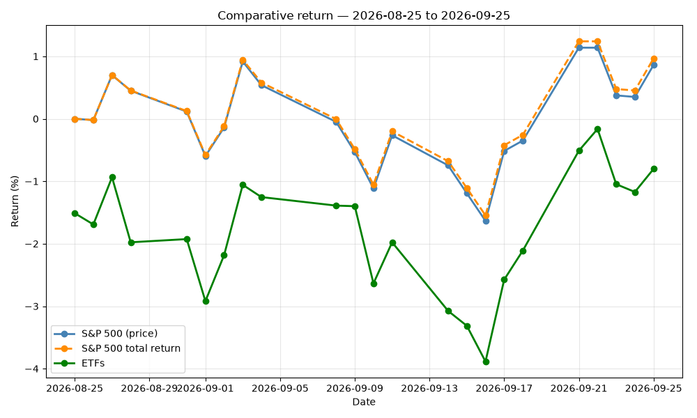
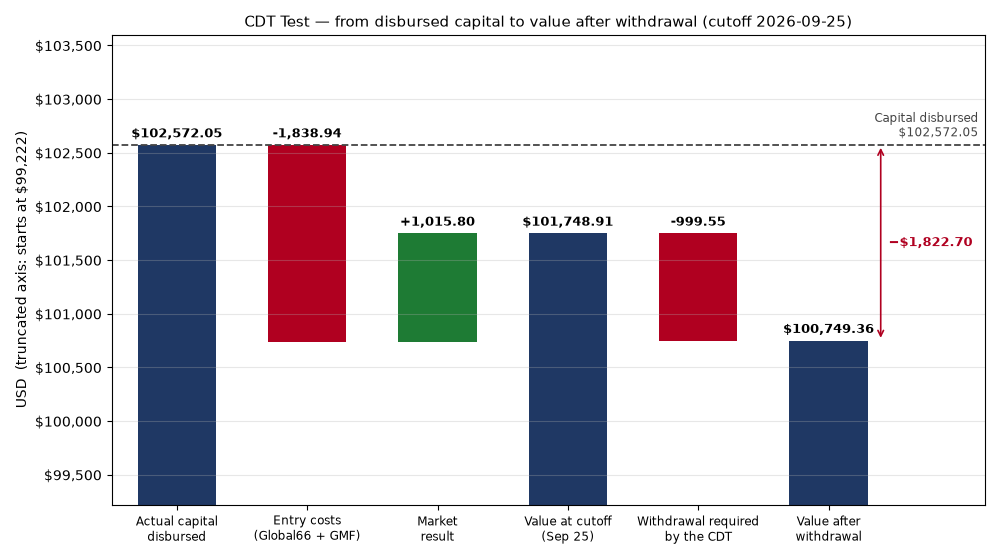
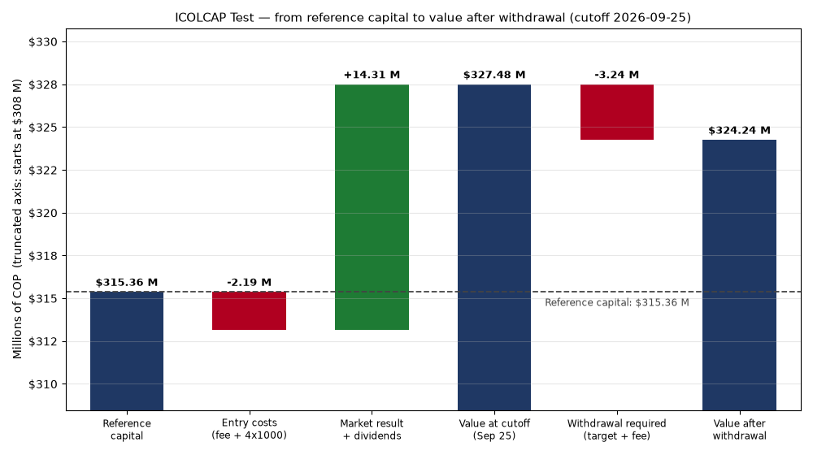

# ETF Portfolio vs. Colombian CDT: An Analysis in Python

Can an investment portfolio pay the same monthly return as a Colombian CDT (*certificado de depósito a término*, a fixed-term deposit) **without touching the original capital**? This project tests two portfolios against that benchmark: a **diversified, dollar-denominated ETF portfolio** and a **single-ETF portfolio in pesos, ICOLCAP** (the ETF tracking the MSCI COLCAP index). It uses real prices, real dividends and real transaction costs, and presents the results as executive reports.

## The question

A CDT at **13% E.A.** (effective annual) yields **1.0237% per month**. For each portfolio, the test asks whether it could fund that same monthly withdrawal, in pesos, while its value after the withdrawal stays **at or above the capital the investor actually disbursed**.

Both portfolios start from the same capital ($315,357,771.28 COP) and follow the same rules, so each one answers the same question against the same CDT:

| Test | Portfolio | Currency | Costs modeled |
|---|---|---|---|
| ETF test | 13 diversified U.S.-listed ETFs (14 after a rebalance) | USD | Global66 conversion fee (1.4% in, 3% out), GMF (4x1000), Global66 exchange rates |
| ICOLCAP test | ICOLCAP (ETF tracking the MSCI COLCAP) | COP | Trii purchase/sale fees, VAT, GMF (4x1000) |

## First-month results (cutoff: September 25, 2026)

| | ETF portfolio | ICOLCAP portfolio |
|---|---|---|
| Net return on capital | -0.80% | +3.85% |
| Entry costs | 1.79% of capital | 0.69% of capital |
| Value after the CDT-equivalent withdrawal vs. capital | **-1.78%** (not met) | **+2.82%** (met) |







- The ETF portfolio returned -0.80% net, against +0.97% for the S&P 500 in total return (^SP500TR). Before entry costs it returned about +1.01%: the gap comes from one-time entry costs, not from the investments.
- The ICOLCAP portfolio met the condition: ICOLCAP rose +4.55% in the month. The analysis also shows the condition would have failed with a price decline of about 2.7% from the cutoff close.
- **The two results are not a like-for-like comparison of management.** The ETF portfolio is measured in dollars and is exposed to the exchange rate; the ICOLCAP portfolio is measured in pesos and has no currency exposure. They are two answers to the same question under different conditions.
- One month is not enough to judge a strategy; the reports detail the sensitivities and limitations.

## Repository structure

```
etf-portfolio-vs-cdt-analysis/
├── code/       Python scripts
├── reports/    Executive reports (PDF, English)
└── images/     Charts used in this README
```

### Code

| Script | What it does |
|---|---|
| `compare_portfolio_transaction_ledger.py` | Builds the ETF portfolio from a transaction ledger and compares it with the S&P 500 (total return and price index) |
| `tnx_and_historical_analysis.py` | 10-year Treasury yield (^TNX) movement over the period and historical performance of the original 13 positions |
| `cdt_portfolio_test.py` | CDT equivalence test for the ETF portfolio, with a waterfall chart |
| `icolcap_portfolio_test.py` | CDT equivalence test for the ICOLCAP portfolio (COP, Trii), with a waterfall chart |

### Reports

- [ETF portfolio: first-month executive report](reports/executive_report_etfs_sep25_2026.pdf)
- [CDT equivalence test (ETF portfolio)](reports/executive_report_cdt_sep25_2026.pdf)
- [ICOLCAP equivalence test](reports/executive_report_icolcap_sep25_2026.pdf)

## Methodology highlights

- **Total-return benchmark:** the S&P 500 is measured with ^SP500TR (dividends reinvested), the industry standard, with the price index shown only as context.
- **Real capital disbursed:** returns are measured against the capital that actually left the investor's account, including conversion fees and the GMF (Colombia's 4x1000 financial transactions tax).
- **Cash handled as a position:** leftover cash and dividends are tracked as `CASH` at $1.00, dated on their real payment day.
- **Hard condition:** the portfolio value after the withdrawal must be greater than or equal to the capital disbursed; otherwise no sale is executed that month.
- **Positions at a loss are never sold** to fund the withdrawal.

## Getting started

```bash
git clone https://github.com/anturiam1/etf-portfolio-vs-cdt-analysis.git
cd etf-portfolio-vs-cdt-analysis
pip install -r requirements.txt
python code/cdt_portfolio_test.py
```

Each script has a parameters section at the top (cutoff date, exchange rates, fees). To evaluate another month, edit those values and run it again.

## Assumptions and limitations

- Fees and exchange rates come from Global66 and Trii quotes; Global66 changes its fees by day and amount range, so exit fees are a documented assumption.
- ICOLCAP prices and dividends are entered manually (no free API from the Colombian Stock Exchange).
- Each run starts from the initial purchase; chaining several monthly cutoffs is a planned improvement.
- No withholding tax on dividends is applied (amounts are below the exemption threshold).

## Tools

Python, pandas, yfinance, matplotlib, and Claude (Anthropic) as an AI assistant. All code was reviewed and corrected by the author.

## Author

**Andrés Mauricio Ruiz Anturi**
International Business Professional · Specialist in Finance · Data Analyst

## Disclaimer

This project is for educational and analytical purposes only. It is a simulation and does not constitute investment advice.
